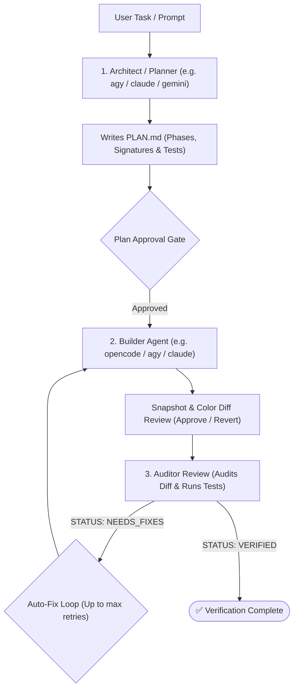

# autodev-orchestrator (SpeiiDev) 🥬

> **Interactive Multi-Agent Terminal User Interface (TUI)** and autonomous workflow orchestrator with pluggable AI coding agents, model switchers, diff gates, and conversation memory. Fully cross-platform across **macOS, Linux, and Windows**.

---

## Architecture & Workflow



---

## Key Features

- **Multi-Agent Orchestration**: Separate roles for **Planner/Auditor** (generates and verifies [`PLAN.md`](PLAN.md) without modifying source code) and **Builder** (implements the code).
- **Pluggable CLI Adapters**: Works seamlessly with:
  - `agy` (*Google Antigravity CLI*)
  - `opencode` (*OpenCode CLI*)
  - `gemini` (*Google Gemini CLI*)
  - `claude` (*Anthropic Claude Code CLI*)
- **100% Cross-Platform (macOS, Linux, & Windows)**:
  - Resolves Windows `.cmd`, `.bat`, and `.exe` wrappers automatically via `get_safe_executable()`.
  - Platform-aware subprocess handling (`shell=True` on Windows).
  - Normalizes path operations using `pathlib.Path`.
- **Review & Approval Gate**:
  - Live diff inspection with Rich syntax highlighting.
  - Interactive file-by-file rollback support.
  - Configurable permission gate (`ask`, `auto`, `deny`).
- **Rich Interactive TUI**:
  - Built with `prompt_toolkit` and `rich`.
  - TrueColor Pixel Art Green Bok Choy Cabbage logo.
  - Keyboard shortcuts (`F2` Action Menu, `F3` Touched Files Activity Log).
  - Live model switcher and reasoning effort adjuster.

---

## Installation

### From Source

```bash
git clone https://github.com/your-username/autodev.git
cd autodev

# Install in editable mode
pip install -e .
```

### Dependencies

- Python `>= 3.9`
- `rich >= 13.0.0`
- `prompt_toolkit >= 3.0.0`
- *Optional:* `Pillow >= 9.0.0` (for image pixel art rendering)

---

## Quickstart

### Launch Interactive TUI

```bash
autodev
# or
speiidev
```

### Run an Automated Task Directly

```bash
autodev "Implement JWT authentication and unit tests"
```

### Auto-Approve Plans and Diffs (`--yes`)

```bash
autodev -y "Refactor database models to SQLAlchemy 2.0"
```

---

## CLI Options

```
usage: autodev [-h] [--plan-file PLAN_FILE] [--max-retries MAX_RETRIES]
               [--conversation CONVERSATION]
               [--planner {agy,opencode,gemini,claude}]
               [--builder {agy,opencode,gemini,claude}]
               [--planner-model PLANNER_MODEL]
               [--builder-model BUILDER_MODEL]
               [--planner-effort PLANNER_EFFORT]
               [--builder-effort BUILDER_EFFORT]
               [--permissions {ask,auto,deny}] [--no-splash] [--no-save] [-y]
               [task ...]

positional arguments:
  task                  Optional task to run immediately

options:
  -h, --help            Show this help message and exit
  --plan-file PLAN_FILE Path to implementation plan (default: PLAN.md)
  --max-retries N       Maximum auto-fix loop attempts (default: 3)
  --conversation UUID   Antigravity conversation UUID to resume
  --planner {agy,...}   CLI backend for planner/auditor role
  --builder {agy,...}   CLI backend for builder role
  --planner-model MODEL Model override for planner
  --builder-model MODEL Model override for builder
  --planner-effort EFF  Reasoning effort for planner
  --builder-effort EFF  Reasoning effort for builder
  --permissions MODE    Permission gate mode: ask | auto | deny
  --font FONT           Render text in 2-line Unicode block art font and exit
  --no-splash           Skip the boot animation
  --no-save             Do not persist session state to disk
  -y, --yes             Auto-approve all plans and diffs (permissions: auto)
```

---

## Interactive Slash Commands & Keybindings

| Key / Command | Description |
| :--- | :--- |
| **`F2`** | Open interactive Action Menu (navigate with arrow keys) |
| **`F3`** | Activity viewer — inspect files and commands touched by agents |
| **`/plan <task>`** | Run only the planner to generate/update `PLAN.md` |
| **`/build`** | Run only the builder to implement code changes |
| **`/audit`** | Run only the auditor to test and verify implementation |
| **`/diff`** | Show color-coded git diff (`+` green new / `-` red old) |
| **`/show`** | Render `PLAN.md` formatted with Rich Markdown |
| **`/font <text>`** | Render text in 2-line Unicode block art font |
| **`/model`** | Search and select models for planner or builder |
| **`/effort`** | Adjust reasoning intensity level |
| **`/perms`** | Configure permission gate mode and manage approvals |
| **`/auto`** | Toggle auto-approve mode on/off |
| **`/conv <id>`** | Set or clear persistent conversation ID |
| **`/log`** | View background activity log and touched files |
| **`/clear`** | Clear screen and redraw banner |
| **`/help`** | Display command reference table |
| **`/exit`** | Quit application |

---

## Typography & Art Styles

SpeiiDev features two terminal typography engines:

### 1. Claude 3D Wireframe Shadow (Default)
Chunky block lettering with an isometric double-line wireframe drop shadow (`═`, `║`, `╚`, `╝`, `╗`, `╔`) in Anthropic Coral (`#D97757`) or Catppuccin Green (`#A6E3A1`):

```
 ▄██████╗ ██╗       ▄█████╗  ██╗   ██╗ ██████╗  ███████╗
 ██╔════╝║ ██║      ██╔═══██╗ ██║   ██║ ██╔══██╗ ██╔════╝║
 ██║     ║ ██║      █████████║ ██║   ██║ ██║  ██║ █████╗  ║
 ██║     ║ ██║      ██╔═══███║ ██║   ██║ ██║  ██║ ██╔══╝  ║
 ▀██████╗║ ███████╗ ██║   ███║ ╚███████║ ██████╔╝ ███████╗║
  ╚═════╝╝ ╚══════╝╝ ╚═╝   ╚══╝╝  ╚══════╝╝ ╚═════╝╝ ╚══════╝╝
```

### 2. Compact 2-Line Half-Block Font
Ultra-compact 2-line terminal font for narrow displays:

```
▄▀▀ █▀█ █▀▀ █ █ █▀▄ █▀▀ █░█
▄██ █▀▀ ██▄ █ █ █▄▀ ██▄ ▀▄▀
```

### Generate Block Text Anywhere
- **Standalone CLI**:
  ```bash
  block-font "MY TEXT"                     # 3D wireframe shadow
  block-font "MY TEXT" --style mini        # Compact 2-line
  block-font "MY TEXT" --color bokchoy     # Catppuccin Bok Choy Green
  ```
- **SpeiiDev CLI**: `speiidev --font "MY TEXT"`
- **In REPL**: `/font <text>` (or `/font --mini <text>`)
- **Python API**:
  ```python
  from autodev.font import render_block_text, render_claude_3d_text
  print(render_block_text("SPEIIDEV", style="claude"))
  ```

### Claude Code Custom Output Style
Claude Code provides five built-in output styles (`default`, `concise`, `proactive`, `explanatory`, `learning`) and supports custom styles.

A custom style **`speiidev-block`** is included at `.claude/output-styles/speiidev-block.md` and `~/.claude/output-styles/speiidev-block.md`.

To activate it in Claude Code:
```
/output-style speiidev-block
```

---

## Running Tests

### 1. Isolated Ephemeral Sandbox Test (Real Install Simulation)
Tests the complete packaging workflow from scratch—creating an isolated sandbox in `/tmp`, installing `autodev-orchestrator`, verifying real console binaries (`speiidev`, `block-font`), and running all tests with **zero changes to your system**:

```bash
python3 scripts/test_real_install.py
```

### 2. Fast Unit Test Runner
Run the full 16-test automated suite directly:

```bash
python3 scripts/run_tests.py
# or
python3 -m unittest discover -s tests -v

# Run individual test suites
python3 -m unittest tests/test_font.py -v
python3 -m unittest tests/test_cli.py -v
python3 -m unittest tests/test_pixel_art.py -v
```

---

## Project Structure

```
autodev/
├── .claude/
│   └── output-styles/          # Claude Code custom output styles
│       └── speiidev-block.md   # 3D wireframe shadow font style
├── .gitignore                  # Git ignore rules for Python & Node
├── bin/                        # Executable CLI launchers & wrappers
│   ├── block-font              # 3D block font launcher
│   ├── cli.js                  # Node.js npm/npx wrapper
│   └── speiidev                # SpeiiDev main executable launcher
├── scripts/                    # Development & testing utilities
│   ├── run_tests.py            # Automated unit test suite runner
│   └── test_real_install.py    # Disposable sandbox install & test runner
├── src/                        # Main Python package source
│   └── autodev/
│       ├── __init__.py         # Package entrypoint & public exports
│       ├── __main__.py         # Allows `python -m autodev`
│       ├── cli.py              # Cross-platform SpeiiDev TUI orchestrator
│       ├── font.py             # 3D wireframe shadow & 2-line font engine
│       └── pixel_art.py        # TrueColor ANSI terminal pixel art utility
├── tests/                      # Automated test suite
│   ├── __init__.py
│   ├── test_cli.py             # CLI options, profiles, and state tests
│   ├── test_font.py            # Claude 3D and 2-line font typography tests
│   └── test_pixel_art.py       # TrueColor ANSI half-block renderer tests
├── CLAUDE.md                   # Instructions and branding for Claude Code
├── package.json                # NPM wrapper configuration
├── pyproject.toml              # Build configuration & entry points
├── README.md                   # Documentation
└── speiidev -> bin/speiidev    # Root convenience symlink
```
        ├── __main__.py         # Allows `python -m autodev`
        ├── font.py             # 3D wireframe shadow & 2-line font engine
        └── cli.py              # Cross-platform SpeiiDev orchestrator & TUI with Bok Choy logo
```

---

## License

MIT License. See [LICENSE](LICENSE) for details.
